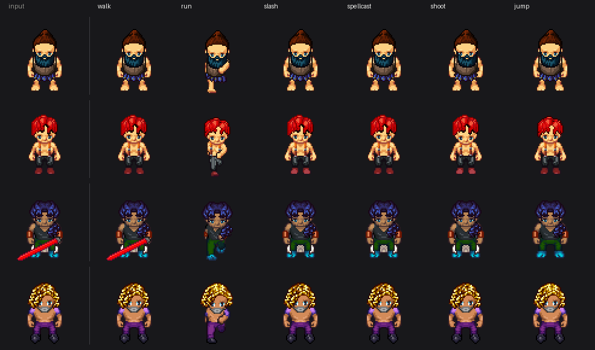
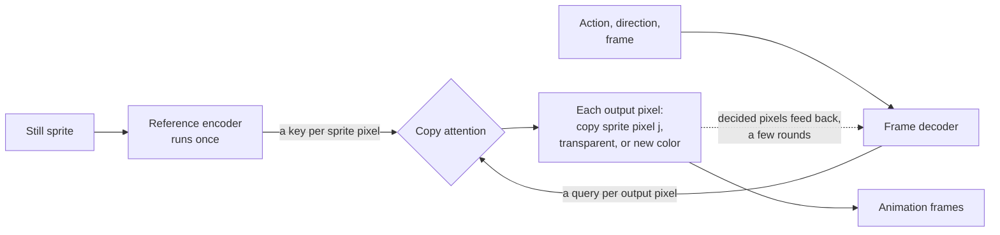

<div align="center">

# moviepix

**A tiny, open model that animates pixel-art sprites, on your own computer.**
Give it one still sprite and an action. It draws the frames.

[](LICENSE)
[](pyproject.toml)
[](#status)
[](https://github.com/Hoopakid/moviepix/actions/workflows/tests.yml)



<sub>Training data: a still sprite (left) and the animations moviepix learns to draw from it.
Characters are composed from <a href="assets/CREDITS.md">Liberated Pixel Cup art</a>.</sub>

</div>

---

## Why

Drawing every frame of a walk cycle by hand is the slow part of pixel art. Tools
that automate it today are mostly closed and run in the cloud. moviepix aims to be an open,
local alternative:

- **Tiny.** A few million parameters; the target is under 20 MB.
- **Local.** Runs on a laptop CPU or in the browser. No account, no API key, no upload.
- **Your art stays yours.** It animates *your* sprite and copies its exact colors instead of repainting it.
- **Fully open.** Code, data pipeline, training recipe, results and costs are all published.

## Status

> **Early research. There are no released weights yet.** Everything below is
> reproducible from this repository today; the first model release will follow
> once the main model beats the baselines (see [Roadmap](#roadmap)).

| | |
|---|---|
| Dataset | ✅ 21,000 composed characters, 15 actions, 4 directions, 64x64 and 32x32 |
| Baselines | ✅ trained and evaluated (below) |
| Main model | ✅ 32x32 and 64x64 trained; beats both baselines |
| Browser demo, weights | ⏳ after the main model |

## How it works



Almost every pixel in a walk frame is a moved copy of a pixel in the still
sprite. Only about 2% of the pixels in our data use a color the sprite does not
have. So instead of painting colors, the main model, `copy_animator`, decides
**which sprite pixel goes where**. The output keeps the sprite's exact palette and
stays crisp, whatever the art style.

It decides in a few rounds (MaskGIT-style): confident pixels first, then the
rest, each round seeing the earlier choices. That keeps uncertain motion
coherent (one sword, not half a sword in two places). The same trained model
can decode in one shot (`steps=1`) for speed, sample variations, or fill in
around pixels you fixed yourself.

More detail: [docs/architecture.md](docs/architecture.md) ·
[docs/decisions](docs/decisions/README.md) (every design choice, with the reason).

## Results so far

32x32, 1,024 validation examples, 640k training examples per model, each trained
on one MacBook Air. "Unseen items" are characters wearing clothes, hair and
weapons that no training character wears.

| Model | Idea | Exact pixels | Exact, unseen items | Silhouette IoU | Uses only sprite colors | Params | CPU, 8 frames |
|---|---|---:|---:|---:|---:|---:|---:|
| A `unet_baseline` | paint each pixel | 0.506 | 0.489 | **0.989** | 0.565 | 2.6M | 11 ms |
| B `palette_tokens` | pick a sprite color per pixel | 0.451 | 0.436 | 0.968 | 0.978 | 2.7M | 23 ms |
| **C `copy_animator`**, one-shot | copy sprite pixels by position | **0.774** | **0.757** | 0.980 | **0.986** | 4.4M | 16 ms |
| **C `copy_animator`**, 8 rounds | same, decided in rounds | 0.765 | 0.749 | 0.973 | **0.986** | 4.4M | 119 ms |

- **C gets about 77% of pixels exactly right, against 51% for the U-Net**, keeps the
  sprite's own colors, and loses little on unseen items. All of it runs well under
  the 200 ms CPU target.
- Picking colors by value (B) keeps colors exact but swaps whole regions to the
  wrong color, so it loses even to plain painting (A). Copying by *position* fixes that.
- **64x64** (one overnight run, 144k examples): 75.8% exact pixels one-shot (75.3% on
  unseen items), 117 ms on CPU for 8 frames.
- Open issues: C's silhouettes are still a little behind A's, and 8-round decoding
  does not yet beat one-shot on these per-pixel scores. Details in
  [docs/decisions](docs/decisions/README.md) (0013, 0015, 0016).

## Quick start

Requires Python 3.12+ and [uv](https://docs.astral.sh/uv/). Training uses Apple
Silicon (MPS), an NVIDIA GPU (CUDA) or the CPU, picked automatically.

```bash
git clone https://github.com/Hoopakid/moviepix.git
cd moviepix
uv sync --extra train

# 1. Art, used as data only (~500 MB)
git clone --depth 1 https://github.com/LiberatedPixelCup/Universal-LPC-Spritesheet-Character-Generator.git data/raw/lpc

# 2. Build the datasets (about 25 min on a laptop CPU)
uv run moviepix-build configs/data/lpc64.toml
uv run moviepix-build configs/data/lpc32.toml
uv run moviepix-view data/built/lpc64 --compare data/built/lpc32   # open the HTML it prints

# 3. Train, evaluate, compare
uv run moviepix-train configs/model/copy_animator.toml
uv run moviepix-eval data/runs/<run> --split unseen
uv run moviepix-compare data/runs/<run-a> data/runs/<run-c> --steps 1 8
```

Training saves checkpoints and continues with `--resume data/runs/<run>`. On
Apple Silicon, GPU memory is capped so the Mac stays usable.

## Local-first targets

These are requirements for a release, measured by `moviepix-eval`
([details](docs/local-first.md)):

| | Target |
|---|---|
| Download | < 20 MB fp16, < 10 MB int8 |
| Speed | < 200 ms for an 8-frame animation on a 4-core laptop CPU |
| Runs in | Python, ONNX Runtime, the browser (WASM / WebGPU) |
| Network | none after download |
| Training | one consumer machine; under $10 of rented GPU, if any |

## Roadmap

- [x] **M1 Data**: LPC composer, permissive-license filter, 64 and 32 px builds, splits, credits, viewer
- [x] **M2 Baselines**: loader, training with resume, metrics, baselines A and B
- [ ] **M3 Main model**: `copy_animator` at 32 px ✅ and 64 px ✅, better iterative decoding, inference CLI
- [ ] **M4 Other art styles**: augmentation, more CC0 sprite sets, out-of-style test set
- [ ] **M5 Release**: ONNX export, browser demo, weights and dataset on Hugging Face, model card

Later: text to sprite, Aseprite and Godot plugins, creatures, side view.

## Known limitations

- Trained only on LPC-style characters (top-down RPG view, humanoid). Other styles
  are the focus of M4.
- Pixel art only, up to 64x64. It does not animate photos or illustrations, by design.
- Some weapons lack frames for some actions and disappear in them (inherited from the source art).

## Data and licenses

- **Code** (and future weights): [Apache-2.0](LICENSE).
- **Training art** comes from the [Liberated Pixel Cup](https://lpc.opengameart.org/) project
  through the [Universal LPC Spritesheet Character Generator](https://github.com/LiberatedPixelCup/Universal-LPC-Spritesheet-Character-Generator),
  read as data only (none of its GPL code is used). Only art available under a
  permissive license (CC0, CC-BY, OGA-BY) is used; every dataset build writes a
  `CREDITS.csv` naming each artist. Images in this README: [assets/CREDITS.md](assets/CREDITS.md).

## Contributing

Issues and pull requests are welcome. Good places to start: sprite sets with
open licenses for M4, test sprites in other styles, and speed on CPU. See
[CONTRIBUTING.md](CONTRIBUTING.md).

## Citation

```bibtex
@software{moviepix2026,
  author = {Hoopakid},
  title  = {moviepix: a tiny open model that animates pixel-art sprites},
  year   = {2026},
  url    = {https://github.com/Hoopakid/moviepix}
}
```

## Acknowledgments

The LPC artists, whose openly licensed work makes this possible (full list in
each build's `CREDITS.csv`). Inspired by [tiny-voca](https://github.com/n4ze3m/tiny-voca),
which showed how far a tiny, fully open model trained on a budget can go.
